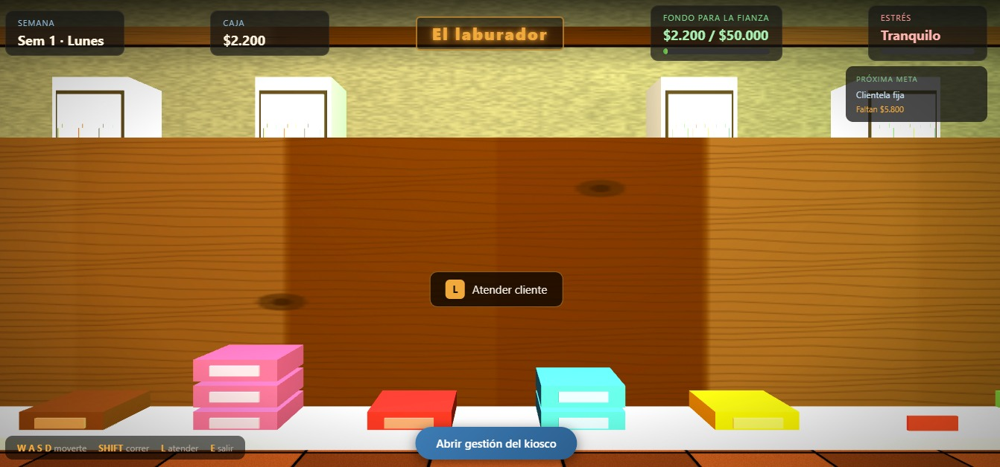

# El Laburador

**Un videojuego educativo de gestión en 3D, ambientado en un kiosco de barrio.**

Tenés ocho semanas para juntar $50.000 y pagar la fianza de tu hermano. Comprás mercadería, fijás precios y atendés por la ventanita. En cada venta calculás el total y el vuelto. Mientras tanto, pagás alquiler y luz, decidís cuándo fiar y elegís cómo responder a las propuestas que aparecen en el barrio.

[**Jugar en la web**](https://aguilarsofiaanto.github.io/el_laburador/) · [**Probar los avances**](https://sobas2785.github.io/el_laburador/)



## Qué practicás

- **Cálculo mental.** Sumás el pedido y calculás cuánto devolverle al cliente.
- **Precios y márgenes.** Decidís cuánto cobrar teniendo en cuenta el costo y cómo cambia la demanda.
- **Stock y caja.** Reponés mercadería según lo que se vende y reservás plata para pagar los gastos del kiosco.
- **Crédito y decisiones.** Evaluás cuándo fiar y qué riesgos tomar para llegar a la meta.

La **Tía Marta** te orienta por chat y puede leer sus respuestas en voz alta. El celular se bloquea mientras un cliente espera el vuelto, así esa cuenta la resolvés vos.

## Cómo jugar

Abrí la presentación y elegí **Jugar**. Para probar una copia local en Windows, instalá Python y abrí [iniciar-servidor.bat](iniciar-servidor.bat). También podés ejecutar esto desde la raíz del repo:

```powershell
python servidor.py
```

Después entrá en [localhost:5517](http://localhost:5517/) y elegí **Jugar**.

| Acción | Teclado y mouse |
| --- | --- |
| Caminar | W, A, S, D |
| Correr | Shift |
| Mirar | Arrastrar el mouse |
| Atender al cliente | L |
| Cerrar el día | E junto a la puerta |

En celular, usá el joystick y los avisos táctiles que aparecen en pantalla.

## Cómo está armado

- [`index.html`](index.html) es la presentación del proyecto y la entrada al juego.
- [`juego/`](juego/) contiene el kiosco 3D, las mecánicas y los recursos. Está hecho con p5.js y JavaScript.
- Firebase Authentication y Firestore permiten guardar y retomar la partida con un usuario anónimo. La Tía Marta usa Firebase AI Logic con Gemini.

Para más detalles, consultá el [manual del juego](juego/README.md), la [configuración de Firebase](juego/FIREBASE.md) y la [guía del chatbot](juego/CHATBOT.md).
